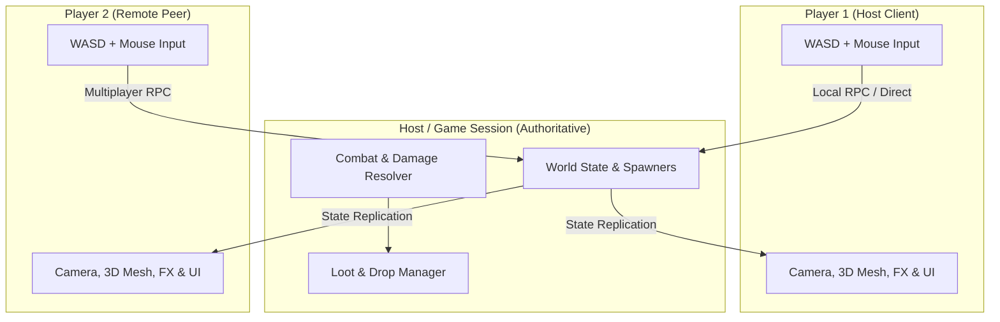
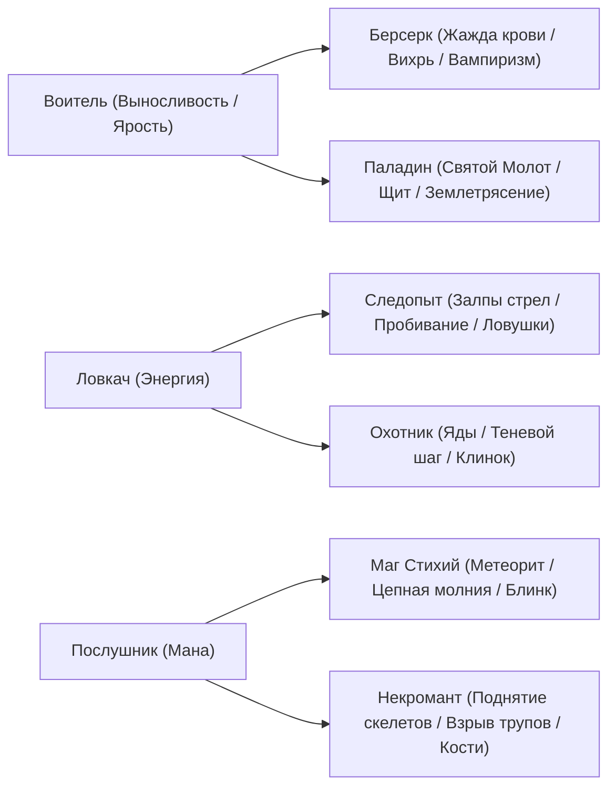

# ⚔️ GDD & Architecture Spec: Diablo-like 2.5D ARPG (Devil Hunter)

## 1. Концепция и видение (Vision)
* **Жанр:** Action RPG / Hack'n'Slash (в духе Diablo 2/4, Hades, Chronicon).
* **Визуальный стиль:** 2.5D Low-Poly 3D с изометрической камерой (угол ~50°), динамическим освещением, туманом и готической темной атмосферой.
* **Управление:** 
  * **WASD** — передвижение (изометрия, скорость 6.8).
  * **Курсор мыши** — направление взгляда / прицел 360°.
  * **ЛКМ** — секторная атака мечом (115°).
  * **Пробел (Space)** — рывок / кувырок с окном неуязвимости (0.35с i-frames).
  * **Q** — активный навык (выбирается в древе навыков: Молот / Вихрь / Громовой удар / Железная кожа).
  * **R** — ультимейт: Землетрясение (AoE-разлом земли, отбрасывание, тряска камеры).
  * **F** — взаимодействие / подбор лута / открытие 3D сундуков / святилища.
  * **K** — древо навыков Diablo 4 style.
  * **I / B** — инвентарь и окно характеристик персонажа.
  * **1** — быстрый глоток зелья здоровья из пояса (до 5 зарядов).
  * **Esc** — закрытие открытых окон интерфейса.
* **Платформа и стек:** PC / Desktop, **Godot Engine 4.7.2** (GDScript + 3D-ноды, GL Compatibility).
* **Сетевой задел (Co-op Ready):** Архитектура Host / Client на встроенном `MultiplayerAPI` Godot.

---

## 2. Архитектура сети и логики

---

## 3. Классы и специализации

---

## 4. Кор-луп геймплея (Core Game Loop)

1. **Хаб (Лагерь Охотников / Деревня):**
   * **Хранилище (Stash):** личный сундук/банк для безопасного складирования лута между вылазками.
   * **Торговец:** скупка ненужного хлама за золото, продажа зелий и редких предметов.
   * **Кузнец:** улучшение и заточка оружия, перековка свойств (Reroll аффиксов).
   * **Портал / Спуск:** переход между безопасным лагерем и боевыми катакомбами.
2. **Экспедиция (Склеп / Подземелья):**
   * Зачистка волн нежити (скелеты-воины, лучники с кайтом, чумные зомби со взрывными ядовитыми лужами).
   * Элитные чемпионы с цветными аурами и опасными аффиксами (*Огненный*, *Ледяной*, *Вампир*).
   * Интерактивные святилища силы на `[F]` (Ярость, Защита, Богатство).
   * Сундуки с лутом разных грейдов (Common, Rare, Epic, Legendary).
   * Выпадение золота, снаряжения, зелий здоровья.
3. **Битва с Боссом («Лорд Склепа»):**
   * Уникальная арена, телеграфные атаки (сокрушительный замах, прыжок с разломом, призыв свиты).
   * Победный взрывной фонтан легендарных наград.
   * Открытие портала спуска на следующий, более глубокий и опасный этаж подземелья либо возврат в лагерь.

---

## 5. Дорожная карта разработки (Milestones & Status)

### ✅ Полностью реализовано и протестировано:

- [x] **Базовый контроллер игрока (`PlayerController.gd`):** сбалансированная скорость (6.8), перекат (16.5) с окном неуязвимости (0.35с), прицел мышью на 360°, расчет поглощения урона броней `damage * (100 / (100 + armor))`.
- [x] **Боевая механика:** секторный взмах мечом (115°), procedural crescent arc, 1 клик = ровно 1 удар по врагу, отбрасывание, тряска камеры.
- [x] **Древо Навыков в стиле Diablo 4 (`SkillTreeUI.gd` + `SkillManager.gd`):**
  - Вызов по клавише `[K]` (с надежной обработкой на любой раскладке) или кнопке в HUD.
  - Кроваво-красные светящиеся трассы, центральный герб «Воитель».
  - 4 активных навыка на `[Q]` (Святой молот, Вихрь, Громовой удар, Железная кожа) с замочком 🔒 до открытия.
  - 8 улучшений и 8 пассивных спутников (вампиризм, криты, скорость, броня, регенерация).
- [x] **Система Лута и Сундуков:**
  - Золото собирается автоматически в упор (`<= 1.0м`).
  - Вещи и зелья подбираются вручную по кнопке `[F]`.
  - Интерактивные 3D сундуки с физической крышкой, пружинным отскоком и фонтаном лута.
  - Готический шрифт Cinzel-Bold для надписей и тултипов.
- [x] **Инвентарь и Кукла экипировки (`[I]` / `[B]`):**
  - 24 слота сумки (4x6) с динамической подсветкой редкостей.
  - 7 слотов куклы снаряжения (Шлем, Амулет, Доспех, Оружие, Щит, 2 Кольца).
  - Живая панель характеристик (Урон, Броня, Здоровье, Крит шанс/урон, Скорость, Золото).
  - Быстрый пояс зелий на клавишу `[1]` с лимитом до 5 штук и отдельным слотом.
  - Экипировка и использование зелий по ПКМ, всплывающие Cinzel-тултипы.
- [x] **Звуковая система (`AudioManager.gd`):**
  - Автономный полифонический звуковой движок на 12 каналов.
  - Процедурный синтез 16-bit PCM WAV звуков (взмахи, удары, криты, звон золота, хруст костей, выстрел лучника, токсичный взрыв, землетрясение).
- [x] **Расширенный Бестиарий и Босс:**
  - **Скелет-Лучник:** кайт от героя при приближении, фиолетовый лазер-телеграф, физические 3D стрелы (`Arrow3D.tscn`).
  - **Чумной Зомби:** живучий танк, взрыв ядовитого облака (`PoisonCloud.tscn`) после смерти.
  - **Босс «Лорд Склепа»:** телеграфы ударов, фазы призыва миньонов, ярость при низком HP, фонтан легендарного лута (Секира Лорда Склепа).
- [x] **Святилища силы и Элитные монстры с аффиксами:**
  - 3D интерактивные святилища на `[F]`: Ярость (+100% крит, +25% скорость атаки), Защита (+75 брони, +8 HP/с реген), Богатство (золотой фонтан + меч).
  - Элитные чемпионы с аурами: *Огненный* (лава `LavaPatch.tscn` + взрыв), *Ледяной* (замедление), *Вампир* (вампиризм 60%).
- [x] **Порталы и Переход на новые уровни подземелий (Dungeon Floors & Portal Descent):**
  - Мистический 3D-портал спуска (`DungeonPortal.tscn`) с вращающимися руническими кольцами и столбом света.
  - Появление портала на месте падения Лорда Склепа по сигналу `Global.boss_defeated`.
  - Взаимодействие на `[F]` открывает кинематографичный готический экран перехода (`FloorTransitionUI.tscn`) с подробными итогами (убитые враги, собранное золото, награда +35% HP).
  - Автоматическая смена биомов локации: **Этаж 1 «Древний Склеп»** $\rightarrow$ **Этаж 2 «Кровавые Катакомбы»** (багровый туман, раскаленный камень, адские факелы) $\rightarrow$ **Этаж 3 «Обитель Хаоса»** (фиолетовый эфир).
  - Прогрессивное масштабирование сложности: враги получают `+25% HP` и `+15% урона` за каждый этаж, возрастает шанс элитников (до 45%), ускоряется спавн.
  - Босс этажа призывается только после зачистки волны (14 убитых монстров на этаже) либо через 45 сек выживания.
  - Индикатор этажа в HUD: `🏰 ЭТАЖ 1: Древний Склеп` с динамическим обновлением.
  - *(Примечание: текущая арена на этажах 2+ служит прототипом логики спуска с динамической сменой биомного света/тумана; полноценная генерация комнат, стен, декораций и 3D-моделей вынесена в отдельный этап).*

---

- [x] **Деревня Охотников (Village Hub), Торговец, Кузнец и Межэтажный цикл:**
  - Игра начинается в безопасной атмосферной средневековой деревне (`TownCamp.tscn`): деревянные бревенчатые дома с двускатными крышами и светящимися окнами, вымощенная камнем центральная площадь, фонарные столбы с теплым янтарным светом, костер охотников (`Bonfire.tscn` +18 HP/сек), сундук-хранилище (`StashChest.tscn`).
  - **Торговец Альдред (`MerchantNPC.gd` + `MerchantUI.gd`):** интерактивный NPC на `[F]` с прилавком и фонарем. Покупка зелий и редкой экипировки, продажа любого лута из сумки за золото в 1 клик (ПКМ/RMB) со звоном монет (`AudioManager.play_gold()`).
  - **Кузнец Брок (`BlacksmithNPC.gd` + `BlacksmithUI.gd`):** интерактивный NPC на `[F]` с каменной кузней, наковальней и пламенем. Заточка и улучшение оружия и доспехов (+1, +2, +3... +25% к характеристикам за каждый уровень улучшения), превью прироста характеристик, звон молота и физическая анимация удара по наковальне.
  - **Межэтажный цикл отдыха и торговли:** после победы над боссом этажа портал спуска переносит героя в деревню для отдыха, продажи лута и улучшения снаряжения, после чего через Врата Катакомб (`CampDungeonGate.tscn`) игрок отправляется на следующий углубленный этаж с сохраненным прогрессом.

---

### ⏳ Текущий этап разработки:

#### 👉 **ШАГ 6: 3D-модели экипировки и оружия в руках героя**
* Отображение надетого оружия (кованый меч, секира Лорда Склепа, паладинский молот) в правой руке героя в реальном времени.
* Отображение экипированного щита (железный баклер, ростовой щит) в левой руке героя.
* Синхронизация визуальных моделей с куклой снаряжения `InventoryUI`.

#### 🧙 **ШАГ 7: Новые классы персонажей и специализации**
* Выбор класса в начале игры: **Воитель** (Берсерк/Паладин), **Ловкач** (Следопыт/Охотник), **Послушник** (Маг Огня / Некромант).
* Система энергии/маны и новые деревья навыков под каждый класс.

#### 💾 **ШАГ 8: Система сохранений (Save / Load)**
* Сохранение инвентаря, надетой экипировки, золота, уровня, очков навыков и личного хранилища Stash в `user://savegame.json`.
* Возможность продолжать экспедиции после перезапуска игры.
